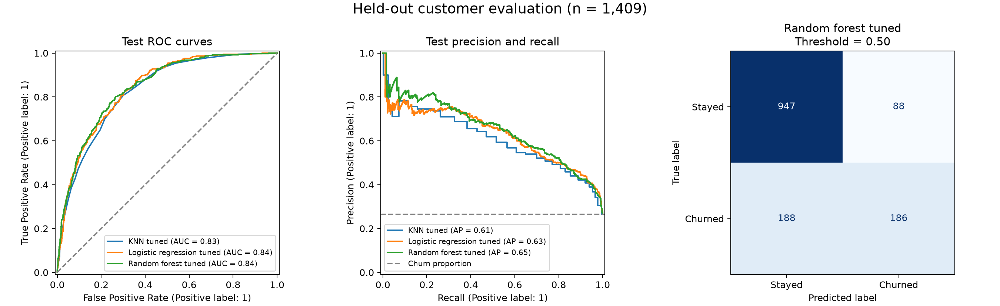

# CM2604 Machine Learning Coursework

Binary classification of telecommunications customer churn using KNN, logistic regression and random forest.

## Project structure

| Folder | Contents |
|---|---|
| src | Dataset preparation, exploratory analysis and model evaluation scripts |
| tests | Checks for metric calculations and preprocessing |
| results | Exploratory figure and aggregate baseline results |
| data | Local copy of the source dataset, excluded from Git |

## Setup

Use Python 3.13. From the project directory in PowerShell, create a virtual environment and install the dependencies.

```powershell
python -m venv .venv
.\.venv\Scripts\python.exe -m pip install -r requirements.txt
```

Download version 1 of BlastChar's Telco Customer Churn dataset and extract `WA_Fn-UseC_-Telco-Customer-Churn.csv` into `data/`. The CSV has 7,043 rows and 21 columns. Its SHA-256 checksum is `88be4b93fbe0cc83421af1c503794c97c342eca914c1576db7c276e61d61358a`. [Source dataset](https://www.kaggle.com/datasets/blastchar/telco-customer-churn)

## Run the analysis

```powershell
.\.venv\Scripts\python.exe src/eda.py
.\.venv\Scripts\python.exe -W error -m unittest discover -s tests -v
.\.venv\Scripts\python.exe src/baseline.py
.\.venv\Scripts\python.exe src/tune.py
.\.venv\Scripts\python.exe src/evaluate.py
```

The exploratory analysis writes `results/training-eda.png`. The baseline comparison writes `results/baseline.json`, including settings, fold scores and software versions. Both scripts resolve paths from their source location.

The tuning script searches 39 parameter combinations on the development folds and writes `results/tuning.json`. Run it before evaluation. The evaluation script fits the fixed baseline and selected settings on the development sample and writes `results/test.json` and `results/test-evaluation.png`. Customer-level test predictions are saved locally in `data/test_predictions.npz` for verification and the subgroup audit.

## Experimental method

The pipeline maps churn to 1 and retention to 0. It reserves a stratified 20% test sample with seed 42. Baseline estimates use five shuffled stratified folds on the remaining 80% and the same folds for every classifier. Scaling and one-hot encoding are learned inside each fitting fold. Numeric inputs are standardised for KNN and logistic regression.

Customer ID, gender and senior-citizen status are excluded from fitting. The demographic fields are retained locally for the subgroup audit. Eleven blank total-charge values occur at zero tenure. Their cumulative charges are estimated as zero under a fixed preparation rule.

Average precision is the primary comparison metric. Precision, recall, F1 and accuracy use a churn probability threshold of 0.50. Hyperparameters are selected using the same development folds as the baseline experiment. The baseline appears first in each grid so it is retained on an exact tie. A random forest with 300 trees and minimum leaf size 15 was nominated using development average precision before test evaluation. Logistic regression retained C = 1. KNN selected 31 uniformly weighted neighbours and Euclidean distance.

## Held-out results

The test sample contains 1,409 customers, including 374 churners. These results compare the six fixed settings.

| Model | Setting | Average precision | ROC AUC | Precision | Recall | F1 | Accuracy |
|---|---|---:|---:|---:|---:|---:|---:|
| KNN | Baseline | 0.506 | 0.778 | 0.542 | 0.500 | 0.520 | 0.755 |
| KNN | Tuned | 0.606 | 0.829 | 0.593 | 0.564 | 0.578 | 0.781 |
| Logistic regression | Baseline | 0.632 | 0.841 | 0.650 | 0.551 | 0.596 | 0.802 |
| Logistic regression | Tuned | 0.632 | 0.841 | 0.650 | 0.551 | 0.596 | 0.802 |
| Random forest | Baseline | 0.609 | 0.818 | 0.614 | 0.511 | 0.558 | 0.785 |
| Random forest | Tuned | 0.652 | 0.843 | 0.679 | 0.497 | 0.574 | 0.804 |

The nominated forest achieved the highest test average precision. Logistic regression achieved higher F1 and recall at the fixed threshold, which shows the trade-off between ranking quality and a particular contact rule. Its baseline and tuned results are identical because the search retained its baseline setting. The development AP difference between the forest and logistic regression was only 0.004, so this experiment supports a cautious comparison.



## Method references

scikit-learn developers (n.d.) *GridSearchCV*. Available at: https://scikit-learn.org/stable/modules/generated/sklearn.model_selection.GridSearchCV.html (Accessed: 23 November 2026).
